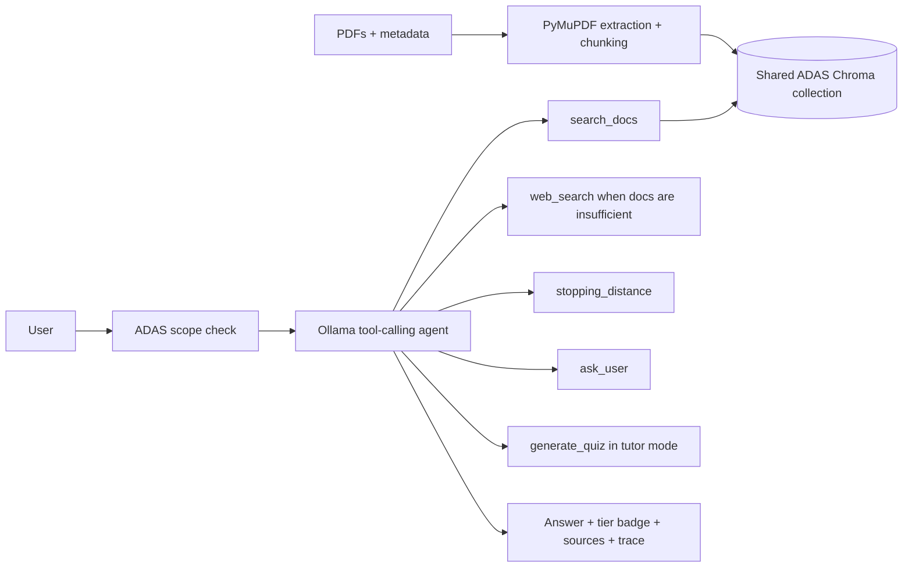

# Sentinel: ADAS Assistant

Sentinel is a local, privacy-friendly chatbot that explains driver assistance systems using your documents, with an AI agent that can also search the web when the documents don't cover a question.

**Why the name:** A sentinel watches the road and guards the driver, like ADAS itself.
---

## What it does

Ask about ADAS systems, operation, limits, vehicle safety, or related
automotive technology. Answers show whether they came from documents, the web,
or general knowledge, with document page citations or web links where relevant.
The agent can also estimate stopping distance, ask for missing vehicle details,
and build quizzes in tutor mode.

---

## Why not just paste the document into a chatbot?

Three reasons, and the third is the one people underestimate:

1. **Context limits.** A 3B model on 8 GB of RAM cannot hold a long document.
2. **Cost and privacy.** PDFs and vectors stay on disk. ADAS assistant web
   searches send the search query to the configured backend when needed.
3. **Accuracy.** Even when a long document *fits*, models attend poorly to one
   relevant sentence buried in fifty pages. Retrieving 3 relevant passages
   produces better answers than supplying 200 pages of mostly-irrelevant text.

RAG reframes the problem from *storage* to **selection**.

---

## How it works



The original uploaded-PDF chat remains available in **Document chat** mode.

### Retrieval and page citations

The shared ADAS index stores both the physical PDF page (`pdf_page`, starting
at 1) and the printed page number (`printed_page`) when it can be read from
the page. Citations use `p. N` for a printed page and `PDF p. N` when no
printed page is available. The same convention is used in answers, source
entries, and image captions. Older indexes without this metadata are detected;
when the corresponding PDF is available locally, Sentinel reports that it is
re-indexing it.

Neighbor expansion is enabled by default through `EXPAND_NEIGHBORS`. After
retrieving the top results, Sentinel can add immediately preceding or
following chunks from the same document for the first two hits. Added chunks
are deduplicated, kept in document order, capped at `TOP_K + 2`, and marked as
neighbors in the sources panel. This helps retain facts and lists that span a
chunk boundary. Set `EXPAND_NEIGHBORS=false` in the environment to turn it off.

For questions about eras or periods, the answer policy asks the model to list
all periods in order with their exact dates. The application also avoids
model-drawn ASCII diagrams; it attaches a chart when a supported chart intent
is detected.

### Charts

Sentinel generates local charts with Matplotlib and serves them through the
existing chart route and image modal. Numeric stopping-distance answers can
include a chart comparing reaction and braking distance across road
conditions. Timeline and evolution questions about ADAS can include a
horizontal timeline based on `data/timelines/adas_eras.json`, which records
five eras from the 2021 ADAS Guide. The 2025-and-later era is labeled as
predicted. Chart generation is optional to the text response: if it fails,
Sentinel still returns the normal answer.

## Answer policy and modes

The ADAS assistant follows three tiers:

1. **Documents:** search the shared ADAS index first and cite supported claims
   with their filename and page.
2. **Web or general knowledge:** if documents do not cover an ADAS question,
   search with the configured `WEB_SEARCH_BACKEND`. Web answers are labeled and
   linked. If search fails or returns no useful results, label the answer as
   unverified general knowledge.
3. **Off-topic:** politely decline questions outside ADAS, vehicle safety, and
   closely related automotive technology.

The assistant asks for make/model/year when a car-specific answer needs those
details. Exact features and thresholds vary by vehicle; check its owner’s
manual. Numeric stopping-distance estimates use the local calculator and are
illustrative only. ADAS assists the driver and does not replace them.

**Tutor mode** explains a system in steps, generates multiple-choice quizzes
from retrieved passages, and grades submitted answers. If no matching
passages exist, it labels a quiz as based on general knowledge.

The essential constraint: **the same embedding model must be used for indexing
and querying.** Different models produce vectors in unrelated coordinate
spaces, and mixing them fails *silently* — no crash, just wrong answers. This
is why every setting lives in one file, `src/config.py`.

---

## Requirements

- Python 3.10+
- [Ollama](https://ollama.com/download)
- ~5 GB free RAM while running

```powershell
ollama pull llama3.2:3b
ollama pull nomic-embed-text
# Model comparison candidate; only one chat model is used at a time
ollama pull qwen2.5:3b

python -m venv venv
venv\Scripts\activate
pip install -r requirements.txt
```

---

## Usage

**Web interface — two options, same pipeline underneath:**

```powershell
streamlit run src\app.py     # Streamlit chat UI
python src\server.py         # Flask + plain HTML/JS, then open http://localhost:5000
```

The Flask option was added because Streamlit's rerun-the-whole-script model
and its own process are avoidable overhead on a machine that is already
tight on RAM. It is not faster to *generate* an answer — the two Ollama
models cost the same ~2.3 GB either way — but it has no framework process of
its own and no browser-tab-plus-session-state machinery sitting between you
and the pipeline. Pick whichever interface you'd rather look at; both call
the same `retrieve` / `build_prompt` / `generate` functions.

**Command line:**

```powershell
python src\embed.py "data\yourfile.pdf"          # index a document
python src\generate.py "your question"            # ask a question
python src\retrieve.py "your question"            # inspect retrieval only
python src\evaluate.py "run label"                # run the test suite
python src\experiment.py "data\yourfile.pdf"      # sweep configurations
python tools\index_adas.py                        # build/update shared ADAS index
python src\agent.py "When does AEB intervene?"     # ADAS tool-calling assistant
python src\eval_adas.py                           # agent vs plain-LLM evaluation
python tools\check_tool_models.py                 # compare small tool models
```

The timeline chart is generated on demand and written to
`results/charts/adas_timeline.png`; stopping-distance charts are also saved
under `results/charts/`. Existing chart files are reused.

In the Flask page choose **ADAS assistant** or **ADAS tutor / quiz** in Answer
mode. These modes search the shared ADAS collection; use Document chat for the
legacy single-upload workflow. The agent mode selects web search itself when
needed, independent of the legacy Web fallback toggle.

## ADAS document indexing and agent

Keep source PDFs in `data/adas/` and edit `data/adas/metadata.json` with one
entry per filename:

```json
{
  "adas_guide.pdf": {"system": "AEB", "source_type": "safety_standard", "car_model": ""},
  "owners_manual.pdf": {"system": "ACC", "source_type": "owners_manual", "car_model": "Toyota Corolla 2024"}
}
```

Run `python tools\\index_adas.py`. The indexer is idempotent: unchanged PDFs
and labels are skipped; changed files or labels are re-indexed into the shared
`adas_documents` Chroma collection. No ADAS documents are included in this
repository. The questions in `questions_adas.json` are **placeholders**; verify
every expected answer and source against your own PDFs before grading results.
`USE_HYBRID` is off until measured on that real question set. Stopping distance
is a simplified estimate for explanation, not a vehicle performance prediction.

---

## Project layout

| Path | Role |
|---|---|
| `src/config.py` | Every setting, in one place |
| `src/ingest.py` | PDF → text → cleaned → chunks (+ context headers) |
| `src/embed.py` | Chunks → vectors → ChromaDB |
| `src/retrieve.py` | Question → most similar chunks |
| `src/generate.py` | Chunks + question → grounded answer |
| `src/agent.py` | ADAS policy, tool loop, answer tier/source assignment |
| `src/citations.py` | Printed-page-first citation formatting |
| `src/charts.py` | Stopping-distance and ADAS timeline chart generation |
| `src/eval_adas.py` | Timestamped ADAS agent vs plain-LLM evaluation |
| `src/app.py` | Streamlit chat interface |
| `src/server.py` + `src/web/index.html` | Flask + plain HTML/JS interface — lighter alternative to Streamlit |
| `tools/index_adas.py` | Idempotent shared ADAS PDF indexer |
| `tools/check_tool_models.py` | Sequential small-model tool-use comparison |
| `data/adas/metadata.json` | Source labels for user-provided ADAS PDFs |
| `data/timelines/adas_eras.json` | Five ADAS eras used by the timeline chart |
| `src/websearch.py` | Optional web fallback (Google or DuckDuckGo, see below) — the only network calls in the project that aren't to local Ollama |
| `src/evaluate.py` | Test suite over `questions.json`, writes reports |
| `src/experiment.py` | Configuration sweeps: chunking, k, header content — retrieval-only |
| `tools/make_test_pdf.py`, `make_messy_pdf.py`, `make_blank_pdf.py` | Generate synthetic test PDFs (clean, multi-column + table, textless) |
| `SPECIFICATION.md` | What is being built and why |
| `CONCEPTS.md` | How each mechanism works |
| `BUILD_LOG.md` | Full development record: every step, problem and fix |

---

## Configuration

All in `src/config.py`:

| Setting | Value | Chosen because |
|---|---|---|
| `CHUNK_SIZE` | 400 words | Specific enough to discriminate, large enough to stand alone |
| `CHUNK_OVERLAP` | 50 words | Measured: beat no-overlap on 5/5 test questions |
| `TOP_K` | 3 | k=1 failed a positional question; k=5 adds chunks at the noise floor |
| `EXPAND_NEIGHBORS` | `True` | Adds adjacent chunks for the top two hits, capped at `TOP_K + 2` |
| `USE_CONTEXT_HEADERS` | `True` | Fixes positional retrieval — see below |
| `HEADER_INCLUDE_FILENAME` | `False` | Filename in the header leaked into every chunk's vector, inflating scores on questions sharing vocabulary with the filename. A/B/C sweep across all 8 test questions showed structure-only headers keep the positional fix and reduce that inflation — see below |
| `USE_HYBRID` | `False` | BM25 + reciprocal-rank fusion stays off until it wins an A/B run on verified ADAS questions |

**Changing any embedding-affecting setting requires re-indexing.** The config
describes intent; the database holds state, and they drift apart silently.

---

## Development history and engineering notes

Development was measurement-driven rather than intuition-driven. `evaluate.py`
runs a fixed 8-question suite and writes timestamped reports to `results/`, so
any change can be compared against a recorded baseline.

### The main finding: a failure hiding behind a passing test

The test suite reported 8/8. Reading the report showed that one question —
*"What happened on the first day of the internship?"* — retrieved the correct
chunk at **rank 2**, not rank 1. The top-ranked chunk did not contain the
answer. The system was returning a correct answer only because `k=3` was wide
enough to sweep the right chunk in as a passenger.

Confirmed by a retrieval-only sweep:

```
k=1: chunks [1]        <- wrong chunk, answer unavailable
k=3: chunks [1, 0, 2]  <- correct chunk present at rank 2
```

**Cause:** embeddings encode meaning, not sequence. Nothing in a chunk's text
states "this is the start of the document," so the question's key term —
*first day* — had nothing to match against. Semantic search is structurally
weak on positional queries.

**Fix:** prepend a context header to each chunk before embedding, so the
missing information reaches the vector:

```
[Source: report.pdf | Part 1 of 8 | This is the BEGINNING of the document:
the first day, the start, the earliest entries | Dates covered: 8 juin 2026]
```

**Result**, against a success criterion set before measuring:

| | Before | After |
|---|---|---|
| Rank-1 chunk | 1 (wrong) | **0 (correct)** |
| Similarity | 0.4923 | **0.5613** |
| Answer content | missing the company name | includes it |

The fix held across all four chunk-size configurations tested.

**Measured cost:** topical questions lost ~0.03 similarity, because the header
adds boilerplate to every chunk and dilutes it. Accepted — a wrong rank-1 is a
failure, while a smaller margin on a question that already ranks correctly is
not.

**Unintended benefit:** one chunk had been acting as a *hub*, ranking second on
five of six questions while answering none — generic topic vocabulary with no
distinguishing content. Headers gave every chunk distinct coordinates, and the
hub dropped out of two result sets entirely.

### Other measured results

- **Overlap works, 5/5.** Comparing 400/50 against 400/0 — identical except
  for overlap — overlap won every question. The largest gain landed on
  end-of-document content, exactly where theory predicts a chunk is most
  likely to be awkwardly framed.
- **Similarity scores cannot be thresholded.** A *correct* top hit scored
  0.4923 while an *irrelevant* one scored 0.4291. Absolute cosine values are
  not calibrated across documents or models; only relative ordering within a
  single query is meaningful.
- **Large chunks stop being retrieval.** At 600-word chunks this document
  produced only 5 chunks, so `k=3` returned 60% of it — document stuffing with
  extra steps. `k` must scale with corpus size.

### Follow-up findings

A later pass closed out several items that had been sitting in "known
limitations" as assumptions rather than measurements.

**Multi-column and table extraction, actually tested.** A synthetic PDF with
a two-column page and a data table (`tools/make_messy_pdf.py`) went through
the full pipeline. Two different results, not one: the two-column prose
extracted in correct reading order — PyMuPDF's block sort handled this
layout fine, which corrects the standing assumption that multi-column always
interleaves. The table did not survive: cell boundaries collapsed into a
single run-on line (`Falcon-9X 214 18,400 47 24 Falcon-7 Lite 96 11,250 34
18 …`), and end-to-end this produced one confirmed wrong refusal — a fact
present in the text (a warranty period) that the model could no longer
locate once the column structure was gone — alongside two other
table-derived facts it answered correctly by counting position. Table
flattening is a real, reproducible failure; multi-column is not always one.

**Header filename leak, measured and reduced.** An A/B/C sweep
(`experiment.sweep_header_filename`) compared no headers, headers with the
source filename, and structure-only headers (position and dates, no
filename) across all 8 test questions. Structure-only headers kept the Day-5
positional fix — the target question's correct chunk stayed at rank 1, with
a *higher* score than the filename variant — and cut the filename-driven
score inflation on the unanswerable salary question roughly in half (+0.048
→ +0.026 over the no-header baseline). It did not reach zero: something
about the chunk's own content, independent of the filename, still gets a
modest boost from having any header at all. Adopted as the new default
(`HEADER_INCLUDE_FILENAME = False`) on the strength of "keeps the fix, costs
less" rather than "costs nothing."

**The test suite can now fail.** It had reported 8/8 in every configuration
ever run through it. Not because nothing was wrong, but because
`expect_any` term lists mixed strong signals (proper nouns, exact numbers)
with generic words a wrong answer could plausibly also contain — "team",
"environment", "job". Tightened to the distinguishing term for the two
affected questions, and added hedge-phrase detection so a keyword match
riding on hedging language ("it is likely…") downgrades to `CHECK` instead
of passing silently.

**A crash found by reading library source, not by triggering it.** A PDF
with no extractable text (a scanned page) yields zero chunks, and Chroma's
`upsert()` rejects an empty `ids` list outright. Neither the Streamlit nor
the Flask UI caught this — it would have surfaced as a raw exception instead
of an explanation. Fixed in both, verified with a purpose-built textless PDF
(`tools/make_blank_pdf.py`) through Flask's in-process test client, which
exercises the failure without starting a server or calling either model.

**A prompt-leakage bug, fixed.** Context blocks were labelled `[Source N -
chunk N]`, and the model occasionally echoed that internal label back
verbatim ("According to chunk 4 of the document…") — meaningless to a reader
who never sees chunk numbers. Relabelled `[Passage N]`, and the system
prompt now explicitly forbids citing internal labels.

---

## Legacy document-chat web fallback

The original Document chat mode retains its opt-in sidebar toggle. In ADAS
assistant/tutor mode, the agent selects web search itself after checking the
shared ADAS library; the legacy toggle does not control agent behavior.
Agent web searches follow the same configured backend described below.

For Document chat mode, the toggle only does anything when **both** are true:

1. You turned it on for this session.
2. The document has already been asked, and the grounded answer looked like
   a refusal (the same `looks_like_refusal()` check `evaluate.py` uses to
   grade the test suite — one definition, used to decide behaviour in two
   places now, not two definitions that could drift apart).

When it fires, the document-chat question goes out to whichever backend `config.py` names
(`WEB_SEARCH_BACKEND`), the top few results are shown as sources, and a
*second*, clearly separate answer is generated from those snippets —
labelled "Web fallback — not from your document" in both UIs, teal instead
of the usual accent colour, so it can never be mistaken for a grounded
answer at a glance. If the search step itself fails, the grounded refusal
above it is untouched — a failed web step is a lost extra, not a failed
turn.

Search queries leave the machine in ADAS agent mode when it needs external
information, and in Document chat mode only when the user enables the toggle.
Local PDFs and embeddings stay on disk.

### Two backends, chosen in `config.py`, not one hardcoded choice

This has genuinely been swapped four times in one session (see
`BUILD_LOG.md`, Days 10–11) — Google first, DuckDuckGo after an
invalid-key wall, back to Google once a real key finally worked, back to
DuckDuckGo once Google's actual final blocker turned up: **it requires a
billing account — a card on file — linked to the Cloud project before the
Custom Search API will serve any request, free tier or not.** No card, no
Google backend, full stop; that's not a setup mistake to keep
troubleshooting, it's a real prerequisite worth knowing *before* spending
twenty minutes in the Cloud console rather than after. Both
implementations stay in `src/websearch.py`, and `config.py`'s
`WEB_SEARCH_BACKEND` picks one, so this doesn't need rewriting a fifth time
if the trade-off ever matters again:

| | `"google"` | `"duckduckgo"` (current default) |
|---|---|---|
| Setup | API key + Search Engine ID + **a billing account (card required)** | None |
| Cost | Free for 100 searches/day *if billing is linked*, then paid | Free |
| Contract | Official, versioned API | Scraped HTML — can break without notice |
| Reliability, measured | Untested past setup — never got a working credential past the billing wall | Rate-limits under repeated use, and the block can last **well over 50 minutes**, not "a minute or two" as first assumed (measured live) |

**Setup for `"google"`**, if you have a card and want to try it:

1. [console.cloud.google.com](https://console.cloud.google.com) → **check
   for a "start your free trial" banner on the project first.** If it's
   there, billing isn't linked yet, and every API call will 403 with
   `"This project does not have the access to Custom Search JSON API"`
   regardless of how correct the key and API setup are — this is what
   actually blocked setup in this session, discovered only after the key
   and API-enablement were already both individually correct. Fix this
   before anything else, via that banner (requires a card) or
   console.cloud.google.com/billing.
2. Enable the "Custom Search API" for the project.
3. Create an API key from **Credentials → "+ Create Credentials" → "API
   key"** directly — not the guided "Help me choose" wizard, which produces
   an OAuth client ID or a service account instead of a plain key. Those
   look similar in the console but are not interchangeable, and this is a
   second real way this setup goes wrong silently.
4. [programmablesearchengine.google.com](https://programmablesearchengine.google.com)
   → create a search engine (adding one placeholder site is required to
   finish creation) → then, in the created engine's **"Display options in
   search results" → "Increasing results"**, toggle **"Search the entire
   web"** on — without this it only ever searches the placeholder site.
   Copy the **Search Engine ID** from the engine's Overview page.
5. Set both as environment variables before starting either UI — not in
   `config.py`, so a real key never sits in a tracked file:

   ```powershell
   $env:GOOGLE_SEARCH_API_KEY = "..."
   $env:GOOGLE_SEARCH_ENGINE_ID = "..."
   ```

6. Restart whichever UI you're running — environment variables are only
   read at process start.

Without both set, the toggle shows disabled in the sidebar with an
explanation, rather than being offered and then failing when clicked.
`src/websearch.py` can be run directly to sanity-check whichever backend is
active, without going through either UI: `python src\websearch.py "your query"`.

**If you see `"API key not valid. Please pass a valid API key."`** — this is
Google rejecting the credential itself, not a quota or permissions problem
(those return different, more specific messages). Check, in order: (1) the
string is from the **API Keys** section of the Credentials page, not an
OAuth client ID; (2) "Custom Search API" is actually **enabled** on the same
Google Cloud project the key belongs to — having a key doesn't enable an
API, that's a separate step; (3) no stray space or quote character got
included when the environment variable was set; (4) the key and the Search
Engine ID weren't swapped into each other's slot.

**Switching to `"duckduckgo"`** needs no setup at all — set
`WEB_SEARCH_BACKEND = "duckduckgo"` in `config.py` and restart. Worth
knowing before relying on it: a second search from the same machine, about
a minute after the first, measured HTTP 202 — DuckDuckGo's anomaly/bot
detection, not a normal result page. One question worked; the next one
shortly after didn't. `search_web()` recognises that specific response and
says so plainly rather than a generic error, but it means this option
trades a credential that can be misconfigured for a scrape that throttles
under exactly the kind of repeated use a real question-answering session
involves.

**What this does *not* change:** `questions.json` and `evaluate.py` are
untouched by this feature — the fallback is opt-in and the evaluation suite
never turns it on, so q7 and q8 (the two questions specifically testing that
the system refuses rather than answering from outside knowledge) still test
exactly what they always did.

---

## Known limitations

- **Scanned PDFs are not supported.** No text layer; would require OCR. This
  now fails with a clear message instead of a crash (see above) — it is
  still not *handled*, only *reported*.
- **Table extraction helps but remains layout-dependent.** PyMuPDF `find_tables()`
  now appends explicit header/value lines; the synthetic warranty table passed
  extraction inspection. Other PDF table layouts still need evaluation.
- **Exact-identifier retrieval remains under evaluation.** BM25 + reciprocal
  rank fusion is implemented behind `USE_HYBRID=False`. There are no real ADAS
  PDFs indexed yet, so it stays disabled until the provided A/B evaluator can
  measure hit rate and rank on verified questions.
- **Header text still leaks into the semantic space, reduced but not
  eliminated.** Dropping the filename from the header (see above) roughly
  halved the score inflation on a topically-related unanswerable question;
  it did not remove it.
- **Validated on small documents.** The core test document is 11 pages, 8
  chunks; the messy-PDF test added a 2-page synthetic document with 1 chunk.
  Retrieval has not been tested at a scale where index search itself is
  under pressure — every test so far returns the entire corpus within `k=3`.
- **200/25 chunking is untested end to end.** It wins every *retrieval-only*
  comparison recorded in `BUILD_LOG.md`, but a full 8-question generation
  run at that setting was attempted and abandoned mid-run when the
  development machine ran low on memory. Retrieval score is a proxy, not a
  verdict — this one is still open.
- **Neither UI has been driven through a live browser session recently.**
  Both `app.py` and `server.py` have had their logic verified — the shared
  pipeline functions via the CLI and test suite, the two UIs' own routes and
  error paths via direct calls and (for Flask) an in-process test client —
  but not a real click-through with a model actually generating on screen,
  to avoid competing with other running applications for RAM on an 8 GB
  machine.
- **The legacy upload chat remains single-document per session.** The ADAS
  assistant uses the separate shared `adas_documents` collection across all
  indexed PDFs.
- **Slow.** 30–100 seconds per answer on CPU, with high variance from model
  loading and memory pressure.

---

## Possible extensions

- OCR for scanned documents
- Reranking with a cross-encoder
- Measure hybrid retrieval after adding verified ADAS documents
- Improve quiz, conversational memory, and evaluation after reviewing the
  placeholder ADAS question set against real sources
